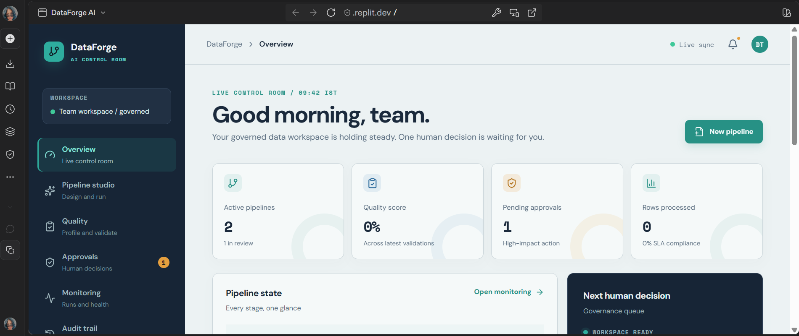
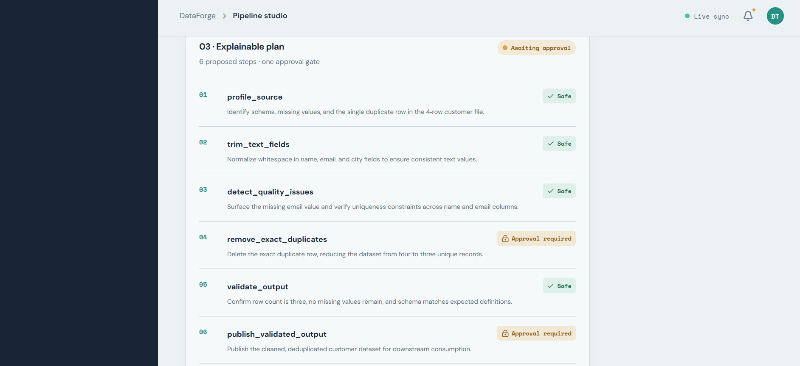

# DataForge AI

A governed data pipeline control room that turns business requirements into explainable, approval-aware workflows with quality validation and audit trails.

An LLM (via Groq) **proposes** the pipeline steps and explains why, but it never decides what is risky. Steps that change or publish data always stop for a human approval, and every action is written to an audit log.

   

   

   

## How it works

1. **Create a pipeline** with a plain-language business requirement.
2. **Attach a CSV source.** The file is parsed in the browser, and only a compact profile (row count, columns, missing cells, duplicate count) is sent to the API.
3. **Get an explainable plan.** The LLM planner picks and orders steps from a fixed set of actions and writes a data-specific reason for each one.
4. **Review and approve.** Risky steps are marked *Approval required* and the agent cannot cross the approval gate without a human decision.
5. **Run and validate.** The pipeline runs, then output checks (row counts, completeness, uniqueness, schema) produce a validation report.
6. **Audit everything.** Each event (plan generated, approval decision, run, validation) is recorded in an activity log.

## The planner (the interesting part)

The planner lives in `artifacts/api-server/src/lib/planner.ts`.

| Action | Risk |
| --- | --- |
| `profile_source` | safe |
| `trim_text_fields` | safe |
| `detect_quality_issues` | safe |
| `remove_exact_duplicates` | **approval required** |
| `validate_output` | safe |
| `publish_validated_output` | **approval required** |

Design choices:

- **Risk comes from a fixed table, not from the model.** Even if the model returns something unexpected, duplicate removal and publishing still need approval.
- **The model's answer is validated before use.** Only known actions, no repeats, 3 to 8 steps, it must start with `profile_source`, run `validate_output` before `publish_validated_output`, and end with publishing.
- **Graceful fallback.** If the key is missing, the Groq call fails or times out (15 seconds), or the plan fails validation, the app uses the original rule-based plan and logs a warning. The audit log says whether the *LLM planner* or the *rule-based planner* produced the plan.
- **Privacy.** Only metadata (file name, row counts, column names, types, missing and unique counts) is sent to the model. Row values never leave the server.

## Tech stack

- **Monorepo:** pnpm workspaces, Node.js 24, TypeScript
- **API:** Express 5, Pino logging
- **Database:** PostgreSQL with Drizzle ORM
- **Validation and API contract:** Zod, OpenAPI spec with Orval-generated client and schemas
- **Frontend:** React, Vite, Tailwind CSS, shadcn/ui, TanStack Query, wouter
- **LLM:** Groq API (`openai/gpt-oss-120b` by default)

## Project structure

```
artifacts/
  api-server/      Express API (routes, planner, logger)
  dataforge-ai/    React frontend (Pipeline studio, dashboard)
lib/
  db/              Drizzle schema and database client
  api-spec/        OpenAPI spec and codegen config
  api-zod/         Generated Zod schemas
  api-client-react/ Generated React Query hooks
scripts/           Workspace scripts
```

## Getting started

This project was built and tested on [Replit](https://replit.com), which provides the database and routes `/api` to the API server.

### 1. Install

```bash
pnpm install
```

### 2. Environment variables

| Variable | Required | Description |
| --- | --- | --- |
| `DATABASE_URL` | yes | PostgreSQL connection string |
| `GROQ_API_KEY` | no | Groq API key. Without it, the rule-based plan is used |
| `GROQ_MODEL` | no | Groq model name. Defaults to `openai/gpt-oss-120b` |

Never commit these values. On Replit, add them under **Secrets**.

### 3. Create the database tables

```bash
pnpm --filter @workspace/db run push
```

### 4. Run

```bash
# API server
PORT=8080 pnpm --filter @workspace/api-server run dev

# Frontend
PORT=21639 BASE_PATH=/ pnpm --filter @workspace/dataforge-ai run dev
```

### 5. Check types

```bash
pnpm run typecheck
```

## Try it

Create a pipeline, then attach this `test.csv`:

```csv
name,email,city
Riya,riya@example.com,Mumbai
Riya,riya@example.com,Mumbai
Amit,amit@example.com,Pune
Neha,,Thane
```

The plan should mention the duplicate row and the missing email, with duplicate removal and publishing marked *Approval required*.

## Known limitations and ideas

- Model-written explanations are advisory and can be slightly off, which is why they never control risk or execution.
- Ideas: unit tests for plan validation, retry with backoff on rate limits (HTTP 429), and a model-comparison view.

## Author

Built by **Riya Patkar** ([@riyax11](https://github.com/riyax11)).

